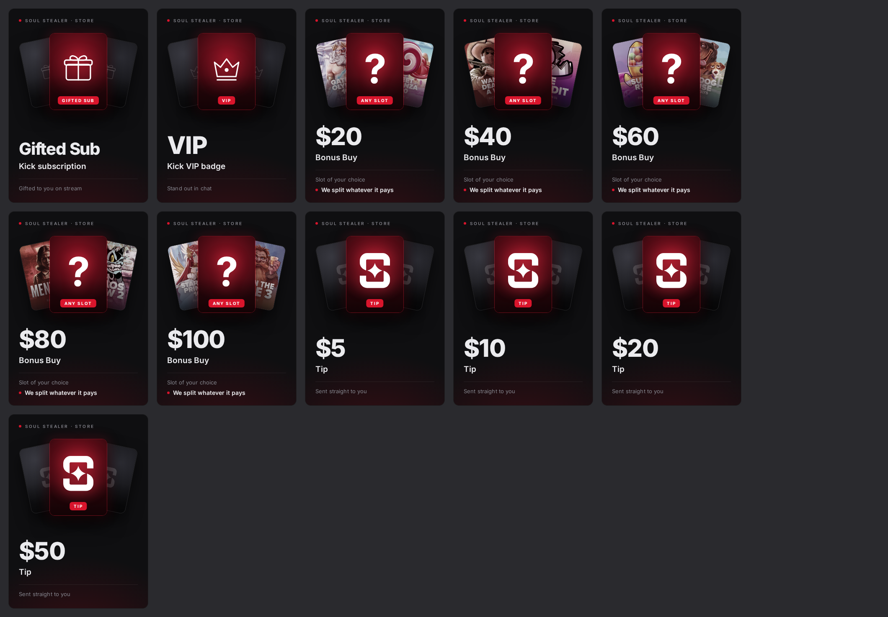

# Store items

Bilder für den Store auf soul-stealer.com, im Stil des Overlays.



Fertige Bilder liegen in `images/`:

| Datei | Größe |
| --- | --- |
| `<item>.png` | 334 × 465 px |
| `<item>@2x.png` | 668 × 930 px (für scharfe Darstellung auf hochauflösenden Bildschirmen) |

Items: `gifted-sub`, `vip`, `bonus-buy-20` … `bonus-buy-100`, `tip-5` … `tip-50`.

## Ändern oder neue Items

Alles steht in `render.cjs`:

- **Texte und Items**: Liste `ITEMS`
- **Slots hinter „ANY SLOT“**: `THUMBS`, pro Bonus-Buy-Stufe ein Paar (links, rechts). Die Bilder liegen in `thumbs/` und stammen aus der `slots`-Tabelle in Supabase (`image_url`). Für andere Slots ein Bild (Hochformat, ca. 3:4) nach `thumbs/<name>.png` legen und den Namen in `THUMBS` eintragen

  | Stufe | Links | Rechts |
  | --- | --- | --- |
  | $20 | Gates of Olympus 1000 | Sweet Bonanza 1000 |
  | $40 | Wanted Dead or a Wild | Le Bandit |
  | $60 | Sugar Rush 1000 | The Dog House Megaways |
  | $80 | Mental 2 | Chaos Crew 2 |
  | $100 | Starlight Princess 1000 | Fire in the Hole 3 |
- **Tip-Logo**: `logos/shuffle.svg` (Shuffle-„S“, von shuffle.com)
- **Icons**: `ICONS`

Neu rendern (im Projektordner):

```bash
npx playwright install chromium   # einmalig
node store-items/render.cjs                 # alle
node store-items/render.cjs bonus-buy-40    # nur eins
```
